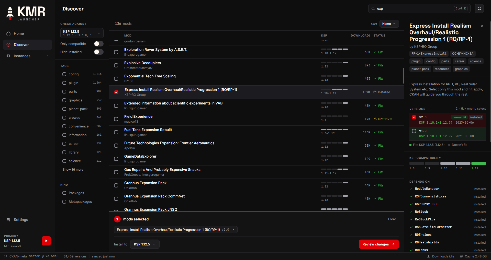

<p align="center">
  <picture>
    <source media="(prefers-color-scheme: dark)" srcset="docs/logo/logo-dark.svg">
    
  </picture>
</p>

<p align="center">
  <strong>A KSP 1 launcher and mod manager for Linux</strong>
</p>

<p align="center">
  <a href="https://github.com/JLS-09/KMR-launcher/releases/latest"></a>
  
  <a href="LICENSE"></a>
</p>

<p align="center">
  <a href="https://github.com/JLS-09/KMR-launcher/releases/latest"><strong>Download</strong></a> |
  <a href="#features">Features</a> |
  <a href="#roadmap">Roadmap</a> |
  <a href="#installing">Installing</a> |
  <a href="#reporting-problems">Reporting problems</a>
</p>

Keep separate KSP installs side by side, each with its own mods, Wine prefix and launch options, and install mods from the same metadata [CKAN](https://github.com/KSP-CKAN/CKAN) uses, with dependencies resolved according to the [CKAN spec](https://github.com/KSP-CKAN/CKAN/blob/master/Spec.md).



> [!WARNING]
> **Version 0.1.1: early release.** KMR Launcher is made by one person (JLS-09) on Linux.
> - **Linux only.** KSP runs through Wine. Windows and macOS aren't supported yet.
> - **Not there yet:** the Home page, offline mode, backups and launching through Proton. See the [roadmap](#roadmap).
> - **Not affiliated with CKAN.** If a mod installed by KMR misbehaves, please [report it here](#reporting-problems), not to the mod's author or to CKAN.

### Try it with your current CKAN install

Already using CKAN? Choose **New instance → From a KSP folder → Copy into KMR** and point it at your KSP folder. KMR makes its own copy and reads CKAN's registry, so your mods come along as picked mods and dependencies, ready to update or remove. **Your original folder isn't changed**, and CKAN keeps working with it.

## Features

- **Instances:** create one from a KSP zip, or from a KSP folder you already have (copied into KMR or used in place, with CKAN-installed mods imported). Each instance has its own mods, Wine prefix, launch arguments and compatible KSP versions.
- **Discover:** search and filter every mod in [CKAN-meta](https://github.com/KSP-CKAN/CKAN-meta), with each mod and version marked against your instance: fits, installed, update available, or not for this KSP version.
- **Dependencies like CKAN:** version ranges, KSP compatibility, conflicts, `provides`, recommendations and suggestions, and choices between alternatives. Problems are shown before anything is installed.
- **Safe installs:** parallel downloads with mirrors, hash checks and a shared cache, CKAN install directives, and a full rollback if something fails or you cancel.
- **Installed mods:** see why each mod is there, update one or all, replace mods that were renamed (`replaced_by`), and remove mods together with dependencies nothing needs anymore.
- **Launching:** start and stop KSP through Wine, with playtime per instance.

## Roadmap

The plan for the next versions. The order can still change.

| Version | Focus | What's coming |
|---|---|---|
| **0.2** | Home and offline | • **Home page:** your last-played instance, updates and other things that need attention, what's new on CKAN, popular mods<br>• **Startup window:** fetches CKAN-meta and checks your instances before the main window opens<br>• **Offline mode:** use the last synced mod list and install mods that are already downloaded |
| **0.3** | Launching and logs | • **Proton:** launch through Proton (via `umu-run`) instead of Wine, per instance<br>• **Logs:** KSP's and Wine's output saved per instance, with a log viewer<br>• **Sorting** the mod list by name, downloads, last updated or author |
| **0.4** | Sharing and backups | • **Export and import** instances as a `.ckan` modpack, compatible with CKAN<br>• **Backup and restore** an instance's mods and saves<br>• **KSP zips from an instance:** a modded instance as a starting point for new ones |
| **0.5** | More mod sources | • **Extra metadata repositories** next to CKAN-meta<br>• **Compact layout** and quick search across mods, instances and actions |
| Later | Other platforms | • **Windows and macOS** support |

## Installing

**Requirements**
- Linux (x64)
- Wine on your `PATH`
- A KSP 1 zip, or a KSP folder you already have (for example Steam's)

Download `KMR-launcher-<version>-linux-x64.tar.gz` from the [latest release](https://github.com/JLS-09/KMR-launcher/releases/latest), then:

```bash
tar -xzf KMR-launcher-*-linux-x64.tar.gz
cd KMR-launcher
./KMRLauncherMvvm
```

The build is self-contained: you don't need to install .NET.

On first start, the launcher clones CKAN-meta in the background. This can take some time depending on your internet speed; Discover shows the progress.

To uninstall, delete the `KMR-launcher` folder, `~/.local/share/kmrLauncher` (mod list and download cache) and `~/.config/kmrLauncher` (settings and the Wine prefixes). Your instances are in `~/.local/share/KMR/instances/` (or the folder you picked) and stay until you delete them.

If a heavily modded instance (such as RP-1) crashes while loading under Wine, add `-force-glcore` to its launch arguments (the instance's Settings tab on the Instances page). It makes KSP use OpenGL directly instead of Wine's Direct3D 11 layer.

## Reporting problems

Please [open an issue](https://github.com/JLS-09/KMR-launcher/issues/new) and include:
- what you did and what happened
- the KSP version of the instance and the mods involved (the instance's Mods tab)
- the launcher's output: start it from a terminal (`./KMRLauncherMvvm`) and copy what it prints around the problem

KMR Launcher is not CKAN. If a mod doesn't install or behave correctly when installed by KMR, report it here first, not to the mod's author or the CKAN team.

## Building from source

Besides the requirements above, you need the [.NET 10 SDK](https://dotnet.microsoft.com/download).

```bash
git clone https://github.com/JLS-09/KMR-launcher.git
cd KMR-launcher
dotnet run
```

If the app still shows an old screen after pulling changes, run `dotnet clean` and build again: Avalonia can keep old compiled XAML around.

**Running the tests**

The xUnit tests in `KMRLauncherMvvm.Tests` cover the dependency resolver, the install flow and pipeline, and instance management:

```bash
dotnet test
```

## Where data is stored

<details>
<summary>Files and folders KMR Launcher uses on Linux</summary>

| Path | Contents |
|---|---|
| `~/.config/kmrLauncher/settings.json` | App settings, KSP zips, the list of instance folders, which one is primary, and the folder new instances go in |
| `<instance>/.kmr/instance.json` | The instance's name, KSP version, compatible KSP versions, launch arguments, Wine prefix path, playtime and last played |
| `<instance>/.kmr/mods.json` | The instance's installed mods and the files each one owns |
| `~/.local/share/kmrLauncher/mods.json` | Cached, parsed mod list |
| `~/.local/share/kmrLauncher/cache/ckan-meta/` | Local clone of CKAN-meta |
| `~/.local/share/kmrLauncher/cache/downloads/` | Verified mod downloads, shared by all instances |
| `~/.local/share/KMR/instances/` | New instances, unless you pick another folder in the New instance dialog |
| `~/.config/kmrLauncher/prefixes/<instance folder>/` | Wine prefix for each instance (the path is saved per instance and can be changed in its Settings tab) |
| `~/.local/share/kmrLauncher/sync.json` | Time and commit of the last CKAN-meta fetch, and the last fetch error |

An instance folder carries its own mod information, so it can be moved, copied or backed up with its mods. If a folder is moved or deleted, the instance shows as missing on the Instances page, where you can locate the folder or remove the instance from the list. Don't edit `.kmr/` by hand.

During an install, files of mods that are being removed or replaced are kept in `.kmr/staging/` inside the instance folder until the install has finished.

</details>

## Built with

- [Avalonia UI](https://avaloniaui.net/) 12 for the user interface
- [CommunityToolkit.Mvvm](https://learn.microsoft.com/dotnet/communitytoolkit/mvvm/) for the MVVM structure
- [LibGit2Sharp](https://github.com/libgit2/libgit2sharp) to clone and update CKAN-meta
- [Humanizer](https://github.com/Humanizr/Humanizer) to format times and sizes
- `Microsoft.Extensions.DependencyInjection` for dependency injection
- [xUnit.net](https://xunit.net/) for the unit tests

## Acknowledgements

Mod metadata comes from the [CKAN](https://github.com/KSP-CKAN) project and its contributors. KMR Launcher is not affiliated with CKAN or with Squad / Private Division.

## License

KMR Launcher is released under the [MIT License](LICENSE).